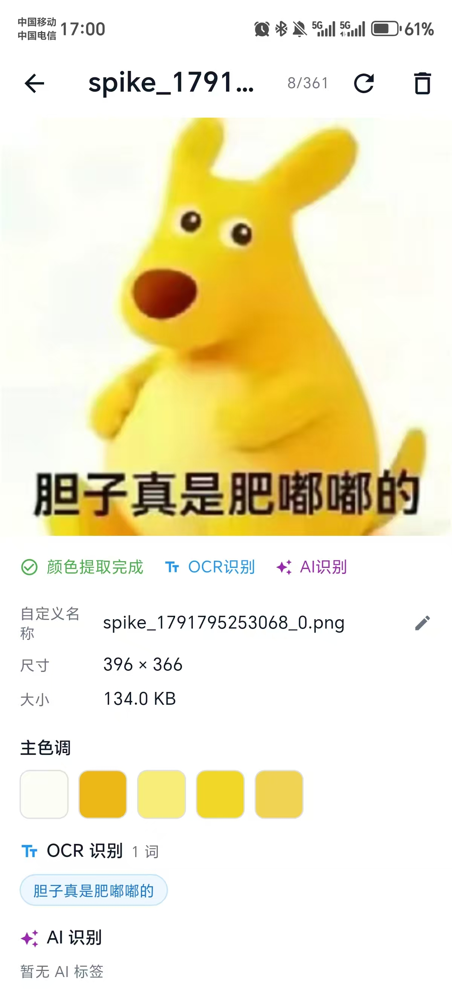

# MemeMaster

<p align="center">
  
</p>

MemeMaster 是一个表情包管理工具，用于导入、整理、搜索和管理表情包图片，支持颜色识别、OCR 文字识别与 AI 语义分析，帮助用户快速找到需要的表情包。

支持 **Linux / macOS / Windows / Android** 多平台，本地优先、数据自持，OCR 与 AI 标签均可离线或本地运行。

## 界面预览

<p align="center">
  
  
  
  
  <br>
  <sub>图库 · 文字搜索 · 颜色搜索 · 详情</sub>
</p>

## 功能

- **图片导入** — 支持图片分享，批量扫描等导入方式，自动去重（SHA256 哈希），按日期归档存储
- **颜色搜索** — HSV 滑块选色，CIE Lab ΔE 色差匹配
- **OCR 文字识别** — Android: Google ML Kit / macOS: Apple Vision / Linux/Windows: Tesseract CLI，支持中英文
- **AI 标签与描述** — OpenAI / Ollama / 本地 LLM 驱动，根据 OCR 结果自动生成标签和文字描述
- **S3 云同步** — 兼容 AWS S3、MinIO、Cloudflare R2、七牛云等 S3 协议存储；基于逻辑时钟的增量双向同步（LWW 冲突消解），支持多设备、删除传播（墓碑）、断点续传
- **配置导出/导入** — 一键备份/恢复 S3、LLM、颜色提取、主题、语言等全部配置，支持文件保存和分享
- **文件夹管理** — 图片分组
- **定时同步** — 可配置的自动同步间隔（5 分钟 ~ 1 天）

## 开发方式

本项目的开发过程中使用了 **Claude Code / Cursor** 等 AI 编程工具辅助实现。

具体分工如下，核心设计与验证由作者完成：

| 环节 | 做法 |
|---|---|
| 一致性引擎实现 | S3 增量双向同步（逻辑时钟 LWW、墓碑删除传播、断点续传、失败重试、manifest 校验）的**代码实现与单元测试用例**由 AI 辅助生成，作者负责设计一致性语义、定义边界条件并复核实现 |
| 服务层样板代码 | `lib/services` 中大量重复的服务样板代码由 AI 生成，作者负责接口契约与跨模块一致性 review |
| 跨平台差异 | 三端 OCR 实现（ML Kit / Apple Vision / Tesseract）与 Vulkan / Metal GPU 加速差异，AI 无法覆盖实际环境，需自行查阅文档并在真机上验证 |
| 验证 | 单元测试与集成测试、断网重连 / 同步中断 / 重复投递 / 双端同时修改等场景验证，以及与 S3 服务端的对拍收敛检查 |

> 一句话总结：**AI 擅长在给定上下文里实现，不擅长定义语义，也处理不了环境差异。**

## 快速开始

### Linux 桌面

#### 基本依赖

```bash
# 核心依赖
sudo dnf install clang ninja-build libsecret-devel gtk3-devel tesseract

# Vulkan GPU 加速依赖（可选，用于本地 LLM 加速）
sudo dnf install vulkan-loader glslc glslang

# Flutter 依赖 + 启动
flutter pub get
flutter run -d linux

# 或构建 release 版本
flutter build linux --release
# 产物: build/linux/x64/release/bundle/meme_master
```

#### Vulkan GPU 加速构建（可选）

如果需要本地 LLM 推理使用 GPU 加速，需要额外配置：

```bash
# 1. 确保 SPIRV-Headers 已构建
./scripts/init-third-party.sh

# 2. 使用 Vulkan 构建
SPIRV_HEADERS_DIR=/path/to/project/third_party/spirv-headers/install \
LLAMA_CPP_DIR=/path/to/project/third_party/llama.cpp \
ENABLE_VULKAN=ON \
flutter build linux --release
```

**验证 GPU 库**：
```bash
# 检查是否生成了包含 Vulkan 符号的 libmeme_llm.so
nm build/linux/x64/release/bundle/lib/libmeme_llm.so | grep vulkan
```

> **注意**:
> - Linux OCR 使用 Tesseract CLI（`google_mlkit_text_recognition` 不可用于 Linux）
> - 需要安装 `tesseract` 和中文语言包 `tesseract-lang`
> - Vulkan 模式需要 Intel/AMD/NVIDIA GPU 驱动支持

### macOS 桌面

#### 系统依赖

```bash
# Xcode Command Line Tools（必须）
xcode-select --install
# macOS OCR 使用 Apple Vision Framework（系统内置，无需额外安装）
```

#### 构建

```bash
# 克隆并构建 C++ 原生依赖
./scripts/init-third-party.sh

# 构建 C++ 原生库（Metal GPU）
./scripts/build-macos-llm.sh

# 构建 release 版本
flutter build macos --release
# 产物: build/macos/Build/Products/Release/meme_master
```

> **注意**: macOS OCR 使用 Apple Vision Framework（系统内置，无需额外安装 Tesseract）。
> **GPU 加速**: macOS 使用 Metal GPU 加速（Apple Silicon M1+ 推荐，Intel Mac 需 OpenCL）。

### Windows 桌面

#### 系统依赖

```bash
# Tesseract OCR (Chocolatey)
choco install tesseract -y

# 或者手动下载安装: https://github.com/UB-Mannheim/tesseract/wiki
```

#### 构建

```bash
# 克隆并构建 C++ 原生依赖
./scripts/init-third-party.sh

# 构建 C++ 原生库（CPU only，Vulkan GPU 可在 Phase 2 启用）
# Windows 使用 CMake 构建 DLL
mkdir -p build/windows-llm
cd build/windows-llm
cmake ../../windows/cpp -DENABLE_VULKAN=OFF
cmake --build . --config Release

# 构建 release 版本
flutter build windows --release
# 产物: build/windows/x64/release/bundle/meme_master.exe
```

> **注意**: Windows OCR 使用 Tesseract CLI（`google_mlkit_text_recognition` 不可用于 Windows）。
> **GPU 加速**: Phase 1 仅支持 CPU 推理，Vulkan GPU 加速在 Phase 2 提供。

### Android (首次构建必读)

Android 构建除了 Flutter 依赖外,还需要把 C++ 原生依赖准备好(llama.cpp、Vulkan SPIRV-Headers、可选 OpenCL),脚本会从 GitHub 克隆并自动构建。

```bash
# 1. 系统依赖 (同 Linux)
sudo dnf install clang ninja-build libsecret-devel gtk3-devel

# 2. Flutter 依赖
flutter pub get

# 3. Android SDK 路径设置 (本项目约定 ~/Software/android-sdk)
export ANDROID_HOME="$HOME/Software/android-sdk"
export ANDROID_NDK="$ANDROID_NDK"  # 启用 OpenCL/Vulkan GPU 加速时必填
export PATH="$PATH:$ANDROID_HOME/platform-tools:$ANDROID_HOME/cmdline-tools/latest/bin"

# 4. 克隆并构建 C++ 原生依赖 (llama.cpp / SPIRV-Headers / OpenCL-*)
./scripts/init-third-party.sh
#    国内网络可配 Gitee 镜像,编辑 DEPS 数组

# 5. 构建 APK
flutter build apk --release       # 产物: build/app/outputs/flutter-apk/app-release.apk
flutter install                  # 安装到已连接设备
```

> 后续更新只需重跑 `flutter pub get` + `init-third-party.sh`(已克隆的依赖会跳过)。

### 环境变量速查

| 变量 | 必填 | 作用 |
|---|---|---|
| `ANDROID_HOME` | Android 编译 | Android SDK 根目录,Gradle 自动检测 |
| `ANDROID_NDK` | GPU 加速 | NDK 根目录,OpenCL 交叉编译需要 |
| `LLAMA_CPP_DIR` | 一般不用 | 覆盖默认 `third_party/llama.cpp` 位置 |

CPU-only 构建只需 `ANDROID_HOME`,GPU 加速(`cmake/build.gradle.kts` 中 `-DENABLE_VULKAN=ON` / `-DENABLE_OPENCL=ON`)还需 `ANDROID_NDK`。

完整环境配置见 [docs/DEVELOPMENT.md](docs/DEVELOPMENT.md),GPU 加速配置见 [docs/GPU_ACCELERATION_FIX.md](docs/GPU_ACCELERATION_FIX.md)。

## 详细文档

| 文档 | 内容 |
|---|---|
| [docs/USAGE.md](docs/USAGE.md) | 用户使用手册（导入/搜索/同步等完整功能） |
| [docs/DEVELOPMENT.md](docs/DEVELOPMENT.md) | 开发者指南（环境搭建/构建/测试/架构） |
| [docs/GPU_ACCELERATION_FIX.md](docs/GPU_ACCELERATION_FIX.md) | GPU 加速（Vulkan/OpenCL）配置与排错 |

## 路线图

- [ ] **UI 优化** — 流畅的动画过渡、移动端适配
- [ ] **llama.cpp 本地推理性能优化** — GPU 加速（cuBLAS/Vulkan）、量化模型加载优化、批处理推理
- [ ] **全平台构建测试** — Linux/Windows/iOS/macOS 跨平台构建验证，修复各平台特定问题
- [ ] **全数据导出 & 压缩包重建** — 将库中所有图片和元数据导出为可移植压缩包（ZIP/TAR），支持从压缩包完整重建
